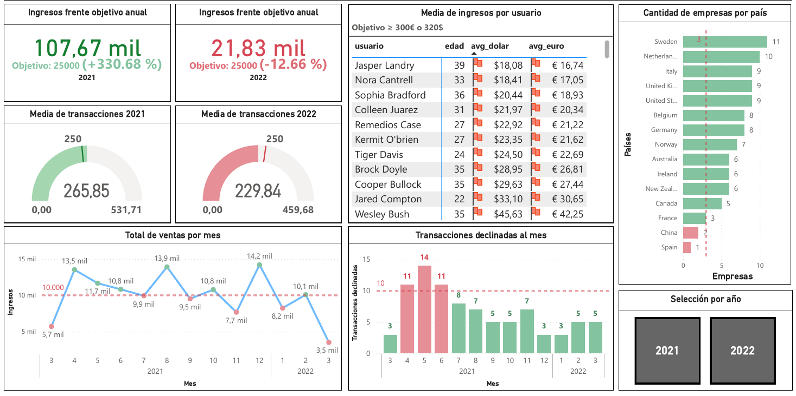
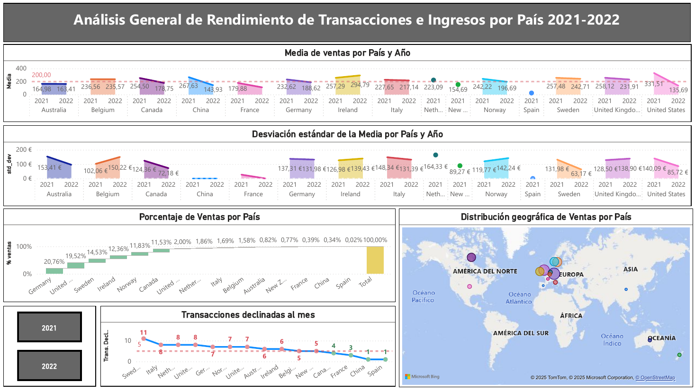

# Sales Analytics Dashboards (Power BI)

Two interactive Power BI dashboards on the sales database built in [DatabaseManagementMysql](https://github.com/Nicolakorff/DatabaseManagementMysql): the first tracks revenue against target, average ticket, monthly sales and declined payments; the second compares average sales and their variability by country and year. Data modelling and measures in Power Query and DAX. Dashboard text is in Spanish.





## Business questions

- Are we meeting the annual revenue target, and how does the average transaction change between 2021 and 2022?
- How do monthly sales and declined payments evolve?
- Which countries concentrate sales, and how stable is the average sale per country and year?
- Where are the companies and the sales located?

## Data

Synthetic sales dataset from bootcamp material (no real customers), loaded from the MySQL star schema: `transactions` (fact) with `users`, `credit_cards`, `companies` and `products` (dimensions). Transactions cover March 2021 to March 2022.

## Dashboard 1: revenue and transactions overview (`dashboards/dashboard_1.pbix`)

- Revenue against the annual target of 25,000: 2021 reaches 107.67k (+330.68 %), 2022 reaches 21.83k (-12.66 %).
- Average transaction: 265.85 in 2021 vs 229.84 in 2022 (gauge against a 250 reference).
- Monthly sales line with a 10k reference, and monthly declined transactions (peak of 14 in May 2021) with a threshold line.
- Average revenue per user, in dollars and euros, against a 300 € / 320 $ target, and number of companies per country.
- Year selector that filters the page.

## Dashboard 2: sales by country (`dashboards/dashboard_2.pbix`)

- Average sale and its standard deviation per country and year, against a 200 reference line.
- Share of total sales by country (waterfall): Germany leads with 20.76 %, followed by Sweden (14.53 %) and Ireland (12.36 %).
- Declined transactions per country and a bubble map of sales by country.

## How to read the results

- **2022 is a partial year** (January to March), so the comparison with the annual target of 25,000 and with 2021 (March to December) is not like-for-like; the -12.66 % does not mean underperformance.
- Percentages of sales by country come from a small dataset (around 15 countries), so differences between neighbouring countries are not statistically tested.

## Repository structure

```
├── dashboards/   # .pbix files (open with Power BI Desktop) and PDF exports
└── docs/img/     # dashboard screenshots
```

The SQL used to build the database lives in [DatabaseManagementMysql](https://github.com/Nicolakorff/DatabaseManagementMysql).

## Tools

Power BI Desktop, Power Query, DAX, MySQL.

## Author

**Nicola Korff** · [LinkedIn](https://www.linkedin.com/in/nicola-korff/)
